<div align="center">

<!-- Aviation-themed hero visualization (animated GIF with static PNG fallback) -->
<picture>
  <source media="(prefers-reduced-motion: reduce)" srcset="assets/hero_flight_radar.png">
  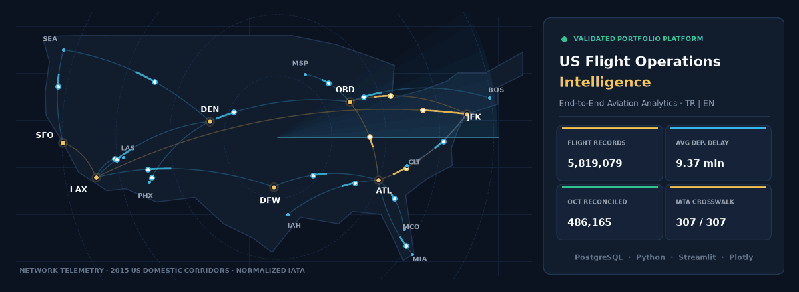
</picture>

<br>

# US Flight Operations Intelligence

**End-to-End Aviation Data Engineering & Interactive Operations Analytics Platform (5.82M US Flights · 2015)**

[](pyproject.toml)
[](sql/create_flights_normalized_view.sql)
[](dashboard/app.py)
[](dashboard/components.py)
[](dashboard/i18n.py)
[](SPRINT_5_RECONCILIATION_IMPLEMENTATION.md)

*Hero graphic above is an aviation-themed network visual built from real US hub coordinates and validated 2015 dataset statistics. All dashboard screenshots below are authentic captures from the running Streamlit application.*

[Overview](#project-overview--validated-statistics) · [Live Dashboard Tour](#live-dashboard-showcase) · [Architecture](#architecture--data-flow) · [Data Reconciliation](#data-quality--october-2015-airport-reconciliation) · [Performance](#query-performance-optimization) · [Quick Start](#installation--local-setup) · [Technical Walkthrough](docs/ARCHITECTURE_WALKTHROUGH.md)

</div>

---

## Project Overview & Validated Statistics

**US Flight Operations Intelligence** is a portfolio-grade Data Analytics and Data Engineering platform built on the **2015 US Department of Transportation (DOT / BTS) domestic flight dataset** (~5.82 million flight records) stored in **PostgreSQL** and served through a custom-designed, bilingual (**TR | EN**) **Streamlit + Plotly** analytical web application.

Rather than stopping at exploratory charts, the project was executed across **11 structured engineering sprints** covering raw schema auditing, discovering and reconciling a real-world October 2015 airport identifier anomaly, building a non-destructive normalized SQL view, optimizing PostgreSQL execution plans and caching, and shipping a commercial-grade dark-navy analytics interface.

### Validated Full-Year 2015 Baseline (Live PostgreSQL Read-Only Checks)

| Metric | Validated Value | Methodology / Source |
|---|---:|---|
| **Total Flight Records** | **5,819,079** | `COUNT(*)` on `public.flights_normalized` (full year 2015) |
| **Average Departure Delay** | **9.37 min** | `ROUND(AVG(departure_delay), 2)` over `5,732,926` non-NULL observations |
| **Average Arrival Delay** | **4.41 min** | `ROUND(AVG(arrival_delay), 2)` over `5,714,008` non-NULL observations |
| **Cancellation Rate** | **1.54%** | `89,884` cancelled flights / `5,819,079` total flights |
| **Diversion Rate** | **0.26%** | `15,187` diverted flights / `5,819,079` total flights |
| **Attributed Delay Hours** | **994,254 hours** | `SUM(cause_delay) / 60` across 5 FAA categories (`departure_delay > 0`) |
| **October 2015 Reconciled Cohort** | **486,165 rows (100%)** | Numeric DOT Airport IDs mapped cleanly to 3-letter IATA codes |
| **Official Airport Crosswalk** | **307 / 307 mappings** | `0` unresolved October origins or destinations (`20 / 20` SQL checks PASS) |

---

## Live Dashboard Showcase

All screenshots below were captured directly from the live local Streamlit application running against PostgreSQL (all 12 months, all 14 carriers).

### Executive Overview — English (`EN`) & Turkish (`TR`)

The top-right **`TR | EN`** switcher translates all 6 pages, sidebar filters, axis labels, tables, status banners, and Plotly hover tooltips across **219 localized keys** while preserving the active page and selected filters across reruns.

| English (`EN`) — Default View | Turkish (`TR`) — Persisted Localization |
|---|---|
| 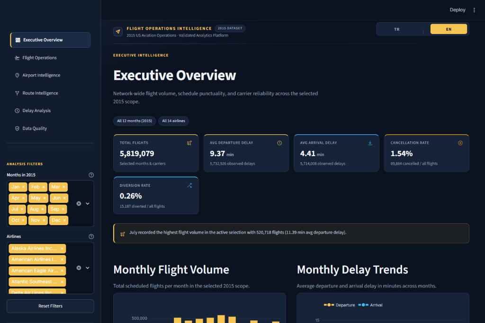 | 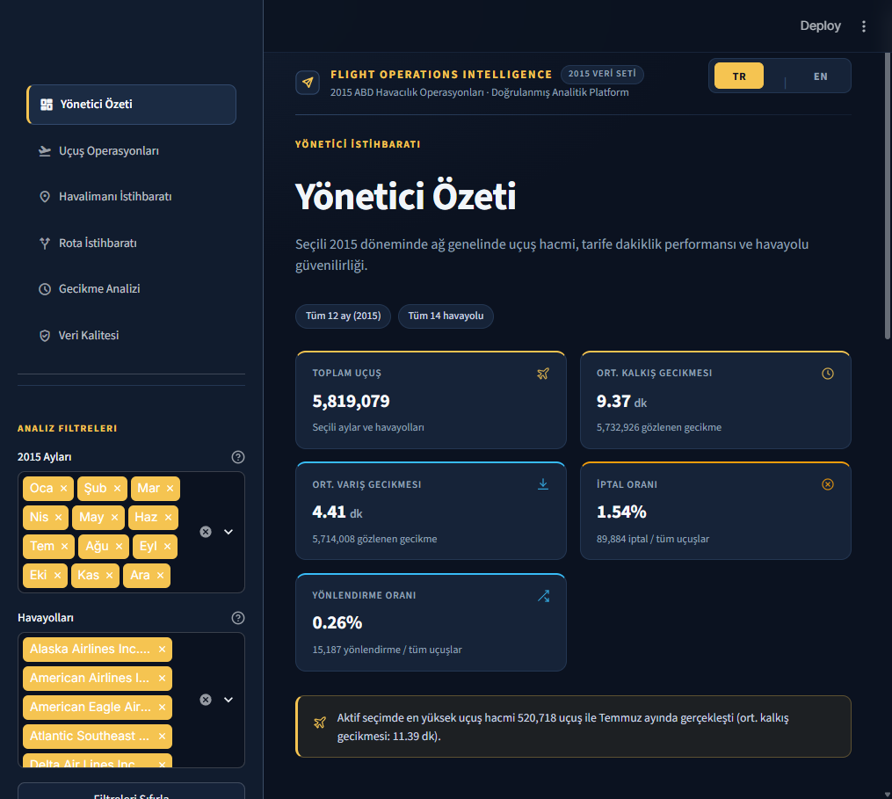 |

### Custom Plotly Hover Tooltips & Root-Cause Breakdown

Every one of the **21 Plotly charts** uses a unified `build_hover()` template with left-aligned dark elevated surfaces, thousands separators, controlled decimal precision, explicit localized units (`flights`/`uçuş`, `min`/`dk`, `hours`/`saat`), and zero raw trace suffixes.

| Readable Airport Tooltip (`Atlanta (ATL)`) | Delay Root-Cause Donut & Attribution Summary |
|---|---|
| 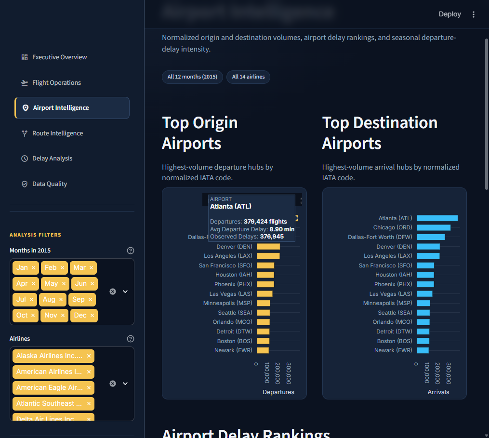 | 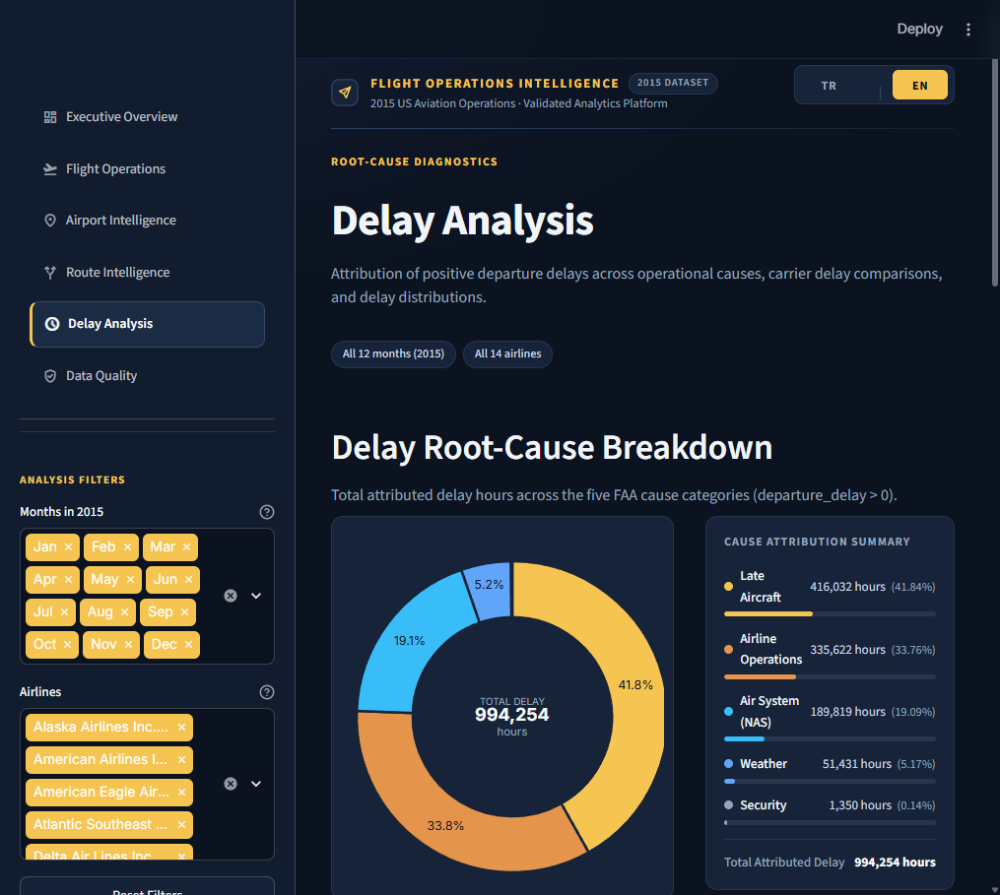 |

### Operational, Airport, Corridor & Data Trust Views

| Flight Operations | Airport Intelligence (Rankings & Heatmap) |
|---|---|
| 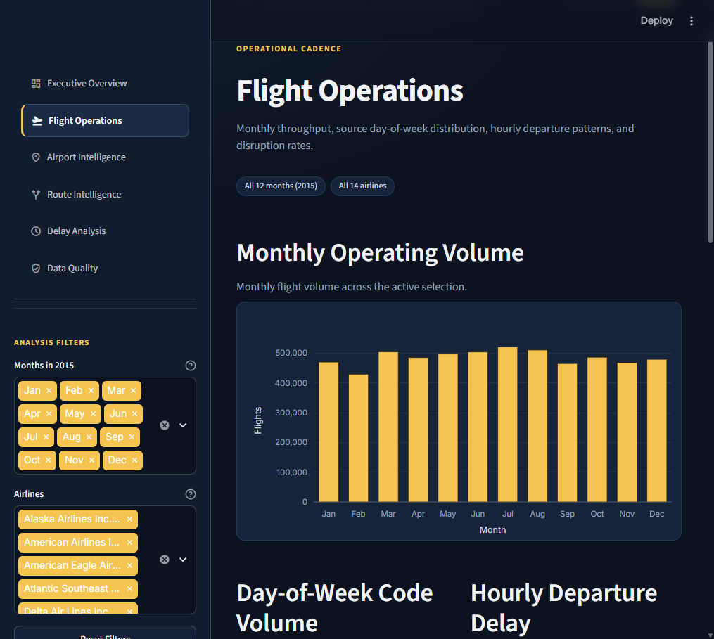 | 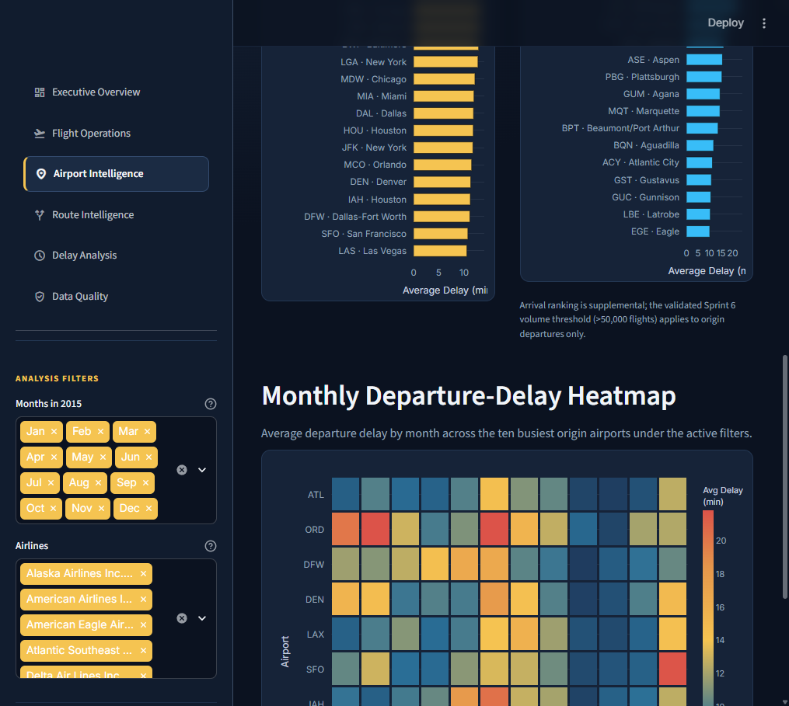 |

| Route Intelligence (Corridors & Delay Profile) | Data Quality (Historical Audit vs. Live SQL) |
|---|---|
| 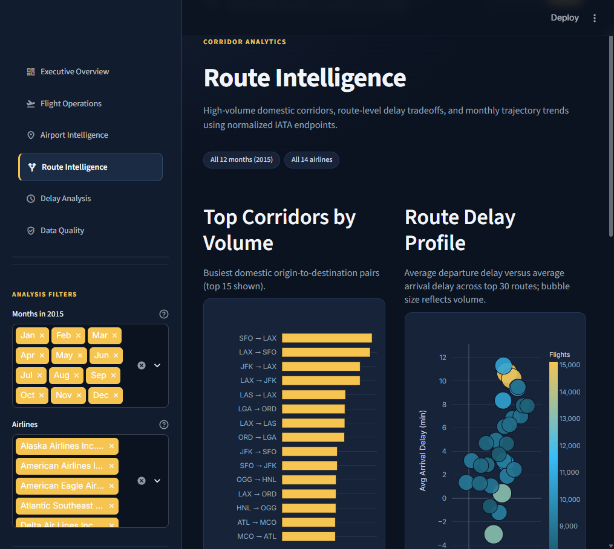 | 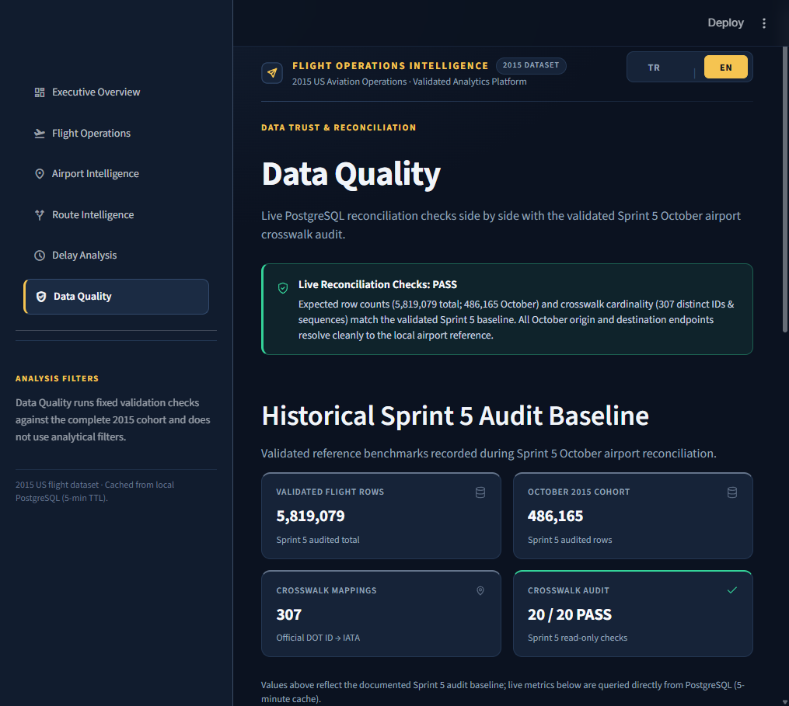 |

---

## Six Analytical Pages

| # | Page (EN / TR) | Analytical Scope & Key Visuals |
|---|---|---|
| **1** | **Executive Overview** / *Yönetici Özeti* | 5 responsive KPI cards (`5,819,079` flights, departure/arrival delays, cancellation & diversion rates), peak-month callout banner, monthly volume bar chart, monthly delay trends, and carrier performance bubble matrix. |
| **2** | **Flight Operations** / *Uçuş Operasyonları* | Monthly operating volume, source `day_of_week` numeric code distribution (preserved without calendar-label assumptions), scheduled departure hour delay curve (00–23), monthly cancellation/diversion trends, and carrier operating volume. |
| **3** | **Airport Intelligence** / *Havalimanı İstihbaratı* | Normalized top origin & destination hubs, departure delay ranking (preserving the Sprint 6 `>50,000`-flight hub eligibility threshold), supplemental arrival ranking, airport/month departure-delay heatmap (Sprint 7 KPI), and expandable summary table. |
| **4** | **Route Intelligence** / *Rota İstihbaratı* | Top 15 domestic corridors by volume, top 30 route delay profile scatter (departure vs. arrival delay), top 10 monthly corridor trends, interactive origin/destination airport selectors, and formatted route performance table. |
| **5** | **Delay Analysis** / *Gecikme Analizi* | FAA 5-cause attribution donut paired with a ranked Cause Attribution Summary card (`994,254` hours total, including `Security` at `0.14%` with zero overlap), stacked monthly delay causes, top-12 carrier comparison, and 30-minute departure/arrival delay distributions. |
| **6** | **Data Quality** / *Veri Kalitesi* | Side-by-side comparison of the Sprint 5 historical audit baseline (`5,819,079` rows, `486,165` Oct rows, `307` crosswalk mappings, `20 / 20 PASS`) against live read-only PostgreSQL reconciliation checks, endpoint coverage cards, and methodology notes. |

---

## Architecture & Data Flow

For a deep dive into SQL query plans, caching internals, security controls, and Streamlit state management, see the **[Technical Architecture Walkthrough](docs/ARCHITECTURE_WALKTHROUGH.md)**.

### End-to-End Platform Architecture

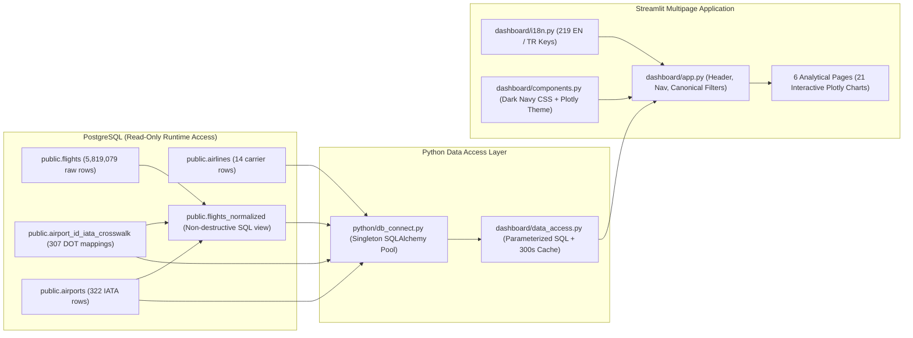

### October 2015 Airport Reconciliation Pipeline

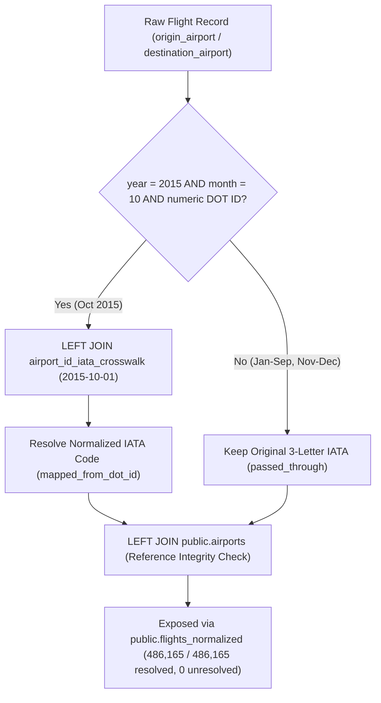

---

## Technology Stack

| Layer | Technology | Role in Project |
|---|---|---|
| **Database** | PostgreSQL | Stores 5.82M flight records, reference tables, official October crosswalk, and `public.flights_normalized` view |
| **SQL & ORM** | SQLAlchemy 2.0 + `psycopg2-binary` | Singleton pooled connection engine, parameterized expanding bind variables, `SET TRANSACTION READ ONLY` enforcement |
| **Data Processing** | Pandas + NumPy | Lightweight aggregation post-sorting, heatmap pivoting, and Plotly customdata shaping (all heavy aggregation stays in PostgreSQL) |
| **Web Application** | Streamlit (`>=1.36,<2.0`) | Multipage navigation (`st.navigation`), 5-minute TTL query caching (`@st.cache_data`), session-state localization & filter persistence |
| **Visualization** | Plotly (`>=5.18,<7.0`) | 21 interactive charts with unified aviation dark theme and localized multi-line hover tooltips |
| **Configuration** | `python-dotenv`, `pyproject.toml` | Local `.env` loading without hardcoded secrets; editable package install (`dashboard` & `flight_analytics_db`) |
| **Static Charts** | Matplotlib, Seaborn, Pillow | Standalone normalized/legacy analytics scripts and optimized README hero GIF/PNG generation |

---

## Data Quality & October 2015 Airport Reconciliation

During **Sprint 2–3** data quality auditing, raw airport aggregations uncovered a silent schema drift in the 2015 DOT flight dataset:

- **The Anomaly:** For **October 2015 only** (`486,165` flights), `origin_airport` and `destination_airport` were encoded as **5-digit numeric DOT Airport IDs** (e.g., `10397` instead of `ATL`) rather than 3-letter IATA codes. Joining `flights` directly to `airports` dropped **100% of October airport & route records** from hub rankings and heatmaps.
- **The Solution (Sprints 4–5):**
  1. Validated an official **307-row October 2015 DOT Airport ID → IATA crosswalk** ([`data/reference/airport_id_iata_crosswalk_2015_10.csv`](data/reference/airport_id_iata_crosswalk_2015_10.csv)) against BTS reference tables (`20 / 20` read-only validation assertions passed in [`sql/validate_airport_reconciliation.sql`](sql/validate_airport_reconciliation.sql)).
  2. Loaded the crosswalk into `public.airport_id_iata_crosswalk` ([`sql/create_airport_id_crosswalk.sql`](sql/create_airport_id_crosswalk.sql)) and exposed normalized endpoints through a **non-destructive SQL view** `public.flights_normalized` ([`sql/create_flights_normalized_view.sql`](sql/create_flights_normalized_view.sql)) — preserving raw flight rows and mapping statuses without mutating source data.
  3. Migrated all analytical SQL queries (Sprint 6), Python visualizations (Sprint 7), and the Streamlit dashboard (Sprints 8–10) to `public.flights_normalized`, with live continuous verification on the **Data Quality** page.

---

## Query Performance Optimization

In **Sprint 9**, plan-only `EXPLAIN` analysis revealed why unfiltered 5.82M-row airport and route queries were taking 13–27 seconds each: joining `public.flights_normalized` to `public.airports` *before* `GROUP BY` caused PostgreSQL to misestimate ~3.89M distinct groups and execute multi-million-row sorts, while `endpoint_metrics` and `airport_ranking` scanned the full table four separate times per page load.

Refactoring to **aggregate by normalized IATA code before joining `public.airports`**, sharing cached aggregates across functions, canonicalizing set-filter cache keys (`sorted(set(...))`), and short-circuiting empty filters via `1 = 0` produced substantial measured gains with **100% verified analytical equivalence** and **zero schema changes**:

| Metric / Page Load (Full 5.82M-Row 2015 Scope) | Before Sprint 9 | After Sprint 9 (Cold) | After Sprint 9 (Warm Cache) | Improvement |
|---|---:|---:|---:|---|
| `endpoint_metrics(origin)` | 14.56 s | 4.30 s | <0.01 s | **3.4× faster** |
| `endpoint_metrics(destination)` | 14.38 s | 4.64 s | <0.01 s | **3.1× faster** |
| `airport_ranking` (origin & dest) | 13.37 s / 13.19 s | **0.004 s** *(shared cache)* | <0.01 s | **Eliminated 2 full scans** |
| **Airport Intelligence (full page)** | **~58.70 s** | **11.73 s** | **0.15 s** | **~5.0× faster cold** |
| `route_metrics` | 27.24 s | 10.90 s | <0.01 s | **2.5× faster** |
| **Route Intelligence (full page)** | **~39.75 s** | **22.46 s** | **0.13 s** | **~1.8× faster cold** |
| **Executive Overview / Operations / Delays / DQ** | — | 4.2 s – 8.4 s | **0.02 s – 0.16 s** | Sub-second warm switching |

Full benchmark methodology and equivalence audit: [`SPRINT_9_BUGFIX_PERFORMANCE_REPORT.md`](SPRINT_9_BUGFIX_PERFORMANCE_REPORT.md).

---

## Installation & Local Setup

### Prerequisites
- **Python 3.10+** (verified on Python 3.11 on Windows)
- **PostgreSQL** with the 2015 US Flight dataset loaded (`flights`, `airlines`, `airports`)

### 1. Install Dependencies & Editable Package

From the project root:

```powershell
python -m pip install -r requirements.txt
python -m pip install -e .
```

The editable install (`pyproject.toml`) registers the `dashboard` and `flight_analytics_db` packages cleanly.

### 2. Configure Database Environment (`.env`)

Copy `.env.example` to `.env` and fill in your local PostgreSQL credentials (never commit `.env`):

```powershell
Copy-Item .env.example .env
```

```env
DB_HOST=localhost
DB_PORT=5432
DB_NAME=airline_db
DB_USER=your_username
DB_PASSWORD=your_password
```

### 3. Prepare Database Schema & Normalized View (First-Time DB Setup)

If setting up a fresh PostgreSQL database after loading raw `flights`, `airlines`, and `airports` CSVs into the tables defined in [`sql/create_tables.sql`](sql/create_tables.sql):

```powershell
psql -h localhost -U your_username -d airline_db -f sql/create_airport_id_crosswalk.sql
psql -h localhost -U your_username -d airline_db -f sql/create_flights_normalized_view.sql
psql -h localhost -U your_username -d airline_db -f sql/validate_airport_reconciliation.sql
```

### 4. Launch the Dashboard

```powershell
streamlit run dashboard/app.py
```

Open the local address printed in the terminal (bound safely to `127.0.0.1` via [`.streamlit/config.toml`](.streamlit/config.toml)).

To enable optional lightweight query timing logs (logs function name, duration, and row count only — never SQL parameters or credentials):

```powershell
$env:DASHBOARD_QUERY_TIMING = "1"; streamlit run dashboard/app.py
```

---

## Project Structure

```text
flight-analytics/
├── .env.example                                   # Safe PostgreSQL credential template
├── .gitignore                                     # Secret, raw-CSV, venv, build & IDE protection
├── .streamlit/
│   └── config.toml                                # Dark-navy theme & localhost-only binding
├── pyproject.toml                                 # Package metadata (dashboard & flight_analytics_db)
├── requirements.txt                               # Pinned runtime dependencies
├── README.md                                      # Portfolio showcase (this file)
├── docs/
│   └── ARCHITECTURE_WALKTHROUGH.md                # Deep-dive engineering & architecture walkthrough
├── assets/
│   ├── hero_flight_radar.gif                      # Animated US flight radar hero (437 KB)
│   ├── hero_flight_radar.png                      # Static hero fallback (109 KB)
│   ├── dashboard/                                 # 8 authentic live Sprint 10 dashboard captures
│   │   ├── executive_overview.png
│   │   ├── executive_overview_tr.png
│   │   ├── flight_operations.png
│   │   ├── airport_intelligence.png
│   │   ├── route_intelligence.png
│   │   ├── delay_analysis.png
│   │   ├── data_quality.png
│   │   └── tooltip_airport_hover.png
│   └── normalized/                                # Sprint 7 normalized Matplotlib heatmap
├── dashboard/
│   ├── app.py                                     # Entry point, navigation, canonical filter stores
│   ├── components.py                              # Design tokens, CSS, KPI grid, Plotly hover/theme
│   ├── data_access.py                             # Read-only parameterized SQL + 300s caching
│   ├── i18n.py                                    # Centralized TR | EN localization (219 keys)
│   ├── README.md                                  # Dashboard-specific run & methodology notes
│   └── pages/
│       ├── executive_overview.py
│       ├── flight_operations.py
│       ├── airport_intelligence.py
│       ├── route_intelligence.py
│       ├── delay_analysis.py
│       └── data_quality.py
├── data/
│   └── reference/
│       └── airport_id_iata_crosswalk_2015_10.csv  # Validated 307-row October 2015 DOT→IATA crosswalk
├── python/
│   ├── db_connect.py                              # Shared singleton SQLAlchemy engine helper
│   ├── normalized/airport_heatmap.py              # Normalized Sprint 7 Matplotlib heatmap script
│   └── *.py                                       # Standalone exploratory chart scripts
├── sql/
│   ├── create_tables.sql                          # Core schema definitions
│   ├── create_airport_id_crosswalk.sql            # Crosswalk DDL & 307 official mappings
│   ├── create_flights_normalized_view.sql         # Non-destructive normalized flights view
│   ├── validate_airport_reconciliation.sql        # 20 read-only reconciliation assertions
│   └── analytics_normalized/                      # Sprint 6 validated analytical SQL queries
└── SPRINT_*_REPORT.md / DATA_QUALITY_AUDIT_*.md   # Complete Sprint 2–11 audit & release reports
```

---

## Limitations & Future Roadmap

### Current Known Limitations
- **Cold Route Query Latency (~11 s per query, ~22.5 s cold page load):** Because `public.flights` (929 MB, 5.82M rows) intentionally has zero database indexes in the current schema and `public.flights_normalized` computes normalized IATA text expressions per row, unfiltered full-year route queries still require sorting ~5.82M rows on first visit. Subsequent visits hit the 5-minute Streamlit cache in `~0.13 s`.
- **Single-Year Scope:** The underlying DOT dataset covers calendar year **2015** only.
- **Local PostgreSQL Requirement:** The live dashboard connects to a local PostgreSQL instance and does not ship with bundled raw flight CSVs (to keep the repository lightweight and respectful of dataset size).
- **Sidebar Multiselect Chip Accent:** Streamlit's BaseWeb multiselect chips inherit `primaryColor` (`#F5C451`) via inline styles, while remaining legible across both languages.

### Planned Future Enhancements (Next Database / Deployment Sprint)
1. **Database Indexing & Materialized Aggregates:** Add a composite B-tree index on `public.flights (year, month, airline)` and a pre-aggregated materialized view at `(year, month, airline, origin_airport_iata, destination_airport_iata)` grain to bring cold Route Intelligence loads under 1 second.
2. **Automated CI Checks:** Add a GitHub Actions workflow running `py_compile`, TR/EN localization parity tests, and secret-hygiene scans on every pull request.
3. **Cloud Read-Only Demo Deployment:** Optionally publish a hosted read-only snapshot backed by pre-aggregated summary tables for one-click browser previews.

---

## Project Attribution & AI-Assistance Disclosure

- **Author:** Eren ([`@qeren3`](https://github.com/qeren3)) — Project architecture, problem framing, dataset acquisition & PostgreSQL setup, sprint direction, domain review, and acceptance validation.
- **AI-Assistance Disclosure:** AI coding assistants (including Claude and Gemini models) were used iteratively across Sprints 2–11 to accelerate SQL reconciliation validation, query-plan diagnostics, Python refactoring, TR/EN localization, UI/UX redesign, automated testing, and technical documentation. Every SQL definition, reconciliation check, benchmark measurement, and visual screen was executed and verified directly against the local PostgreSQL database and live Streamlit application.

### Sprint Documentation Index
- [Sprint 2 — Data Quality Audit](DATA_QUALITY_AUDIT_SPRINT_2.md)
- [Sprint 3 — October Airport Code Investigation](SPRINT_3_AIRPORT_CODE_INVESTIGATION.md)
- [Sprint 4 — Crosswalk Validation](SPRINT_4_CROSSWALK_VALIDATION.md)
- [Sprint 5 — Reconciliation Implementation](SPRINT_5_RECONCILIATION_IMPLEMENTATION.md)
- [Sprint 6 — Analytics SQL Migration](SPRINT_6_ANALYTICS_MIGRATION.md)
- [Sprint 7 — Python Visualization Migration](SPRINT_7_PYTHON_VISUALIZATION_MIGRATION.md)
- [Sprint 8 — Streamlit Import Fix Report](SPRINT_8_IMPORT_FIX_REPORT.md)
- [Sprint 9 — Bug Fix & Performance Optimization Report](SPRINT_9_BUGFIX_PERFORMANCE_REPORT.md)
- [Sprint 10 — UI/UX Redesign & TR/EN Localization Report](SPRINT_10_UI_UX_REDESIGN_REPORT.md)
- [Sprint 11 — Portfolio & GitHub Release Report](SPRINT_11_PORTFOLIO_RELEASE_REPORT.md)
